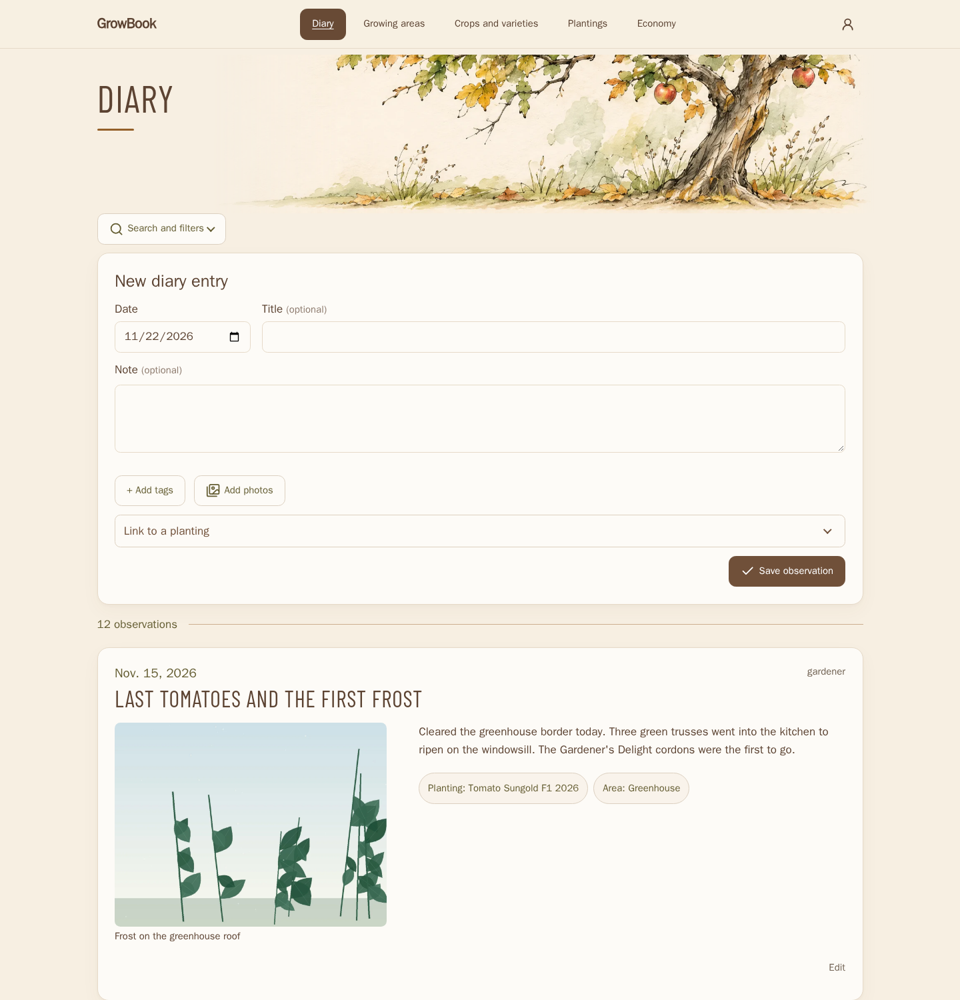
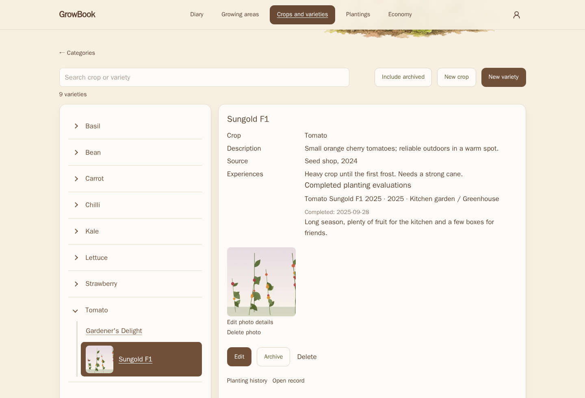
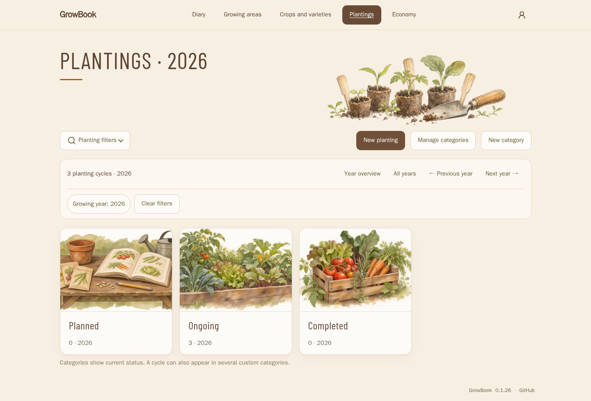
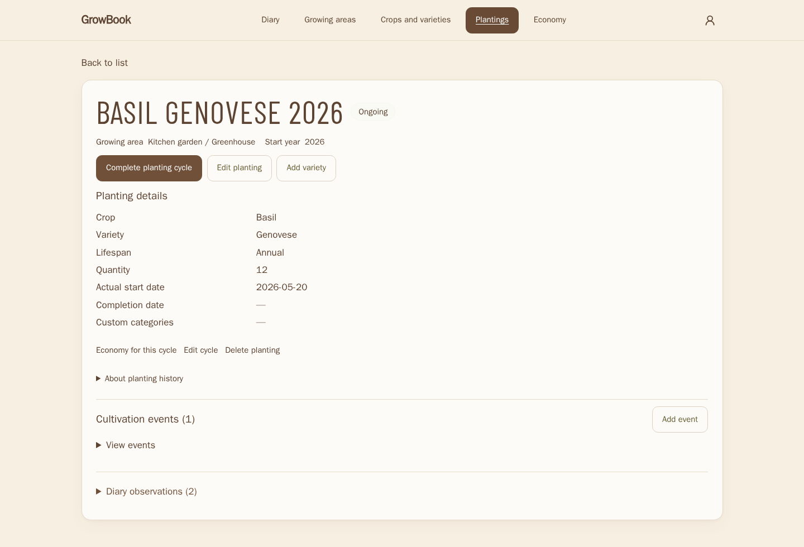
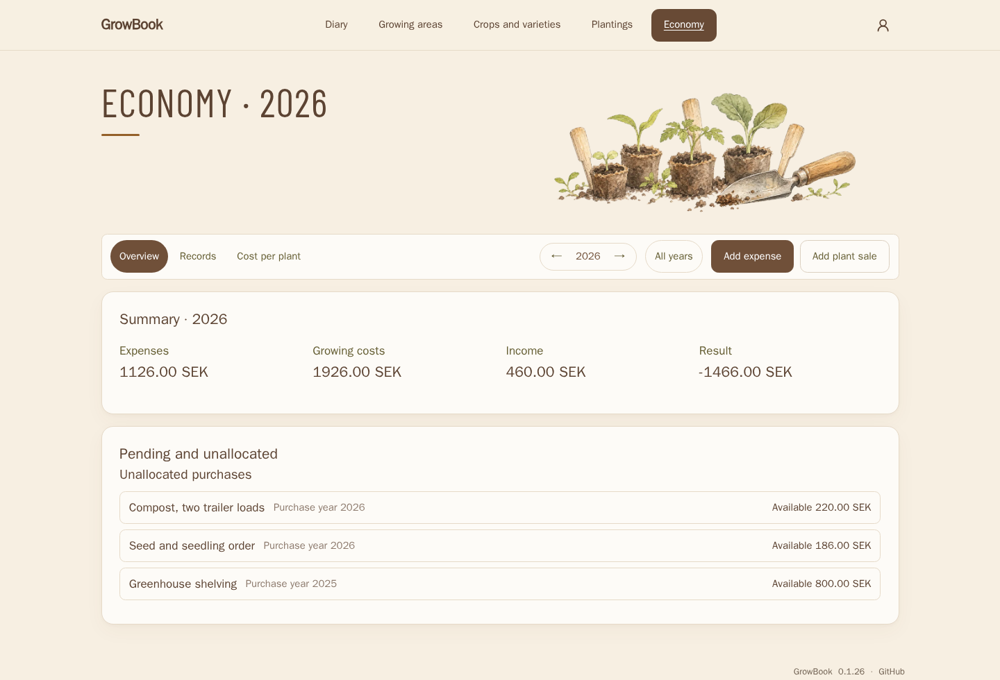
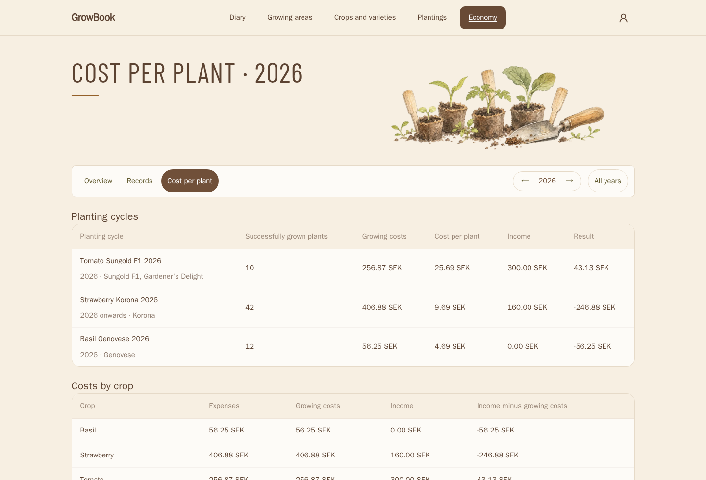

# growbook

<p align="left">
  <a href="https://github.com/MartinWa/growbook/actions/workflows/ci.yml"></a>
  <a href="https://github.com/MartinWa/growbook/releases/latest"></a>
  <a href="https://github.com/MartinWa/growbook/pkgs/container/growbook"></a>
  <a href="LICENSE"></a>
</p>

A private, self-hosted garden diary and planting planner. Growbook keeps your observations,
your crop and variety records, your plans and your growing costs in one SQLite file you own,
and turns them into something you can read back: a seasonal illustrated diary, plantings by
growing year, and a cost per plant.

- **One container, one database file**: no external services, no telemetry, nothing loaded
  from a CDN
- **A diary built for the garden**: notes and photos, optional titles, tags that link an
  observation to a planting, area, crop or variety, and filters across all of them
- **Registers that stay useful**: nested growing areas, a crop and variety register with
  categories and photos, planting plans with batches and milestone events
- **Costs without accounting**: purchases allocated to the growing years and plantings they
  belong to, equipment spread over several years, plant sales, and a cost per plant
- **Made for a household, not the Internet**: accounts created by an administrator, a
  shared garden, private originals, and an interface in Swedish and English

## What it looks like

The screenshots show a demo garden with synthetic data.

**The diary** is the home page: one composer for a new observation, then saved observations
newest first. Notes and photos sit together, and links to plantings, areas, crops and
varieties show up as tags that also drive the filters.



**Growing areas, crops and varieties** are one register each. Areas nest into beds,
greenhouses and plots; crops group their varieties and can be collected into categories for
browsing. Selecting a variety opens its notes, experiences and linked observations beside the
list.



**Plantings** are grouped by growing year and status — Planned, Ongoing and Completed — with
custom categories for anything else. A batch keeps one status and one set of dates while each
variety tracks its own quantity, events, evaluation and photos.





**Economy** follows the growing year: what you spent, what it cost to grow, what you sold and
the result — with purchases allocated to the plantings that caused them and a cost per plant
for every cycle.





## Quick start

Docker with Linux containers and Compose v2 or newer, on `amd64` or `arm64`, behind a
TLS-terminating reverse proxy on a private network.

```sh
cp .env.example .env       # replace every placeholder, including the proxy network
docker compose build growbook
docker compose run --rm growbook python manage.py migrate --noinput
docker compose run --rm growbook python manage.py createsuperuser
docker compose up -d growbook
```

Then attach your proxy to the configured private network, forward it to the `growbook`
service on port `8000`, and sign in through the HTTPS hostname.
[Deployment](docs/deployment.md) covers every setting, both proxy patterns and upgrades.

## Documentation

For using the garden:

- [Getting started](docs/getting-started.md) — signing in, seasons, saving and retries,
  unsaved writing, photos and limits
- [Diary](docs/diary.md) — observations, tags, filters, planting actions while writing
- [Calendar](docs/calendar.md) — the read-only month of planting events and chosen
  observations
- [Growing areas, crops and varieties](docs/garden-registers.md) — registers, categories,
  search, archive and deletion rules
- [Plantings](docs/plantings.md) — batches, statuses, growing years, events, histories
- [Economy](docs/economy.md) — purchases, allocations, equipment, cost per plant, sales
- [API](docs/api.md) — JSON access (reads and validated writes) with a bearer token you create and revoke
  yourself

For running an installation:

- [Administration](docs/administration.md) — accounts and roles, first-run checklist,
  privacy, data safety, upgrades
- [Deployment](docs/deployment.md) — Docker, configuration, reverse proxy, SQLite runtime
- [Backup and recovery](docs/backup-and-recovery.md) — backup, verification, restore and
  orphan cleanup

For contributing:

- [Development](docs/development.md) — container setup, tests, browser suite, styles,
  interface foundations, CI, dependencies and releases
- [Contributing](CONTRIBUTING.md), the [CLA](CLA.md) and the
  [security policy](SECURITY.md)
- [Third-party notices](third_party/README.md) — dependency licensing and native build
  provenance

## License

PolyForm Noncommercial 1.0.0: source-available, not OSI open source. Run, modify and share it
for any noncommercial purpose, including a home garden, a community plot or research use.
Commercial use needs a separate license, arranged through this repository's Discussions. See
[LICENSE](LICENSE) and [NOTICE](NOTICE).

Contributions are accepted under the [CLA](CLA.md), which keeps your copyright and grants the
project the rights that dual licensing needs.
