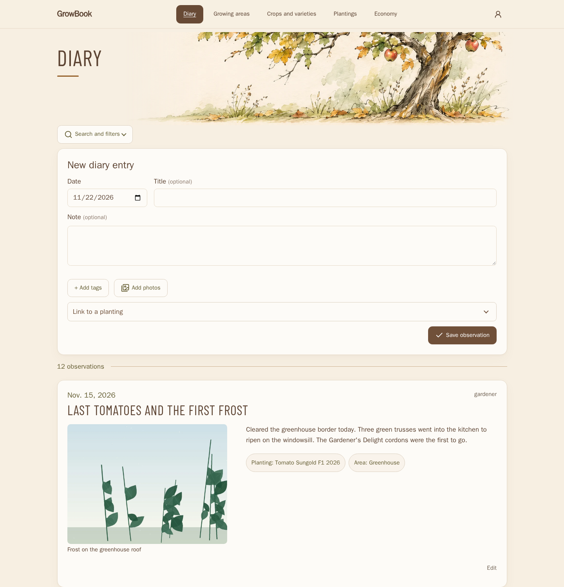

# Diary

The diary is the home page: a new observation on top, then saved observations newest
first. An observation has a date, an optional title, a note, photos or both, plus optional
links to plantings, growing areas, crops and varieties. Shared behavior — saving,
retries, unsaved writing and photo limits — is in [Getting started](getting-started.md).

## Writing an observation

- **Date** defaults to today in the garden's timezone and can be changed.
- **Title** is optional, up to 200 characters. It appears beneath the date on cards and
  observation pages. Leave it blank to use the date as the heading.
- **Note** is free text. An observation needs a note or at least one photo, even when it
  has a title.
- **Add photos** attaches photos to the observation; **Add tags** links it to a planting,
  growing area, crop or variety.
- **Link to a planting** optionally performs one planting action in the same save; see
  [Planting actions while writing](#planting-actions-while-writing).
- **Show in calendar** adds the observation to the [calendar](calendar.md). It is off by
  default, because planting events already appear there. When a ticked observation records
  a planting event in the same save, the calendar shows one item for both and places it on
  the event's date. An observation tagged with a planting but not linked to an event is
  shown with that planting's single event on the observation's own date.
- **Save observation** confirms the save, clears the composer and refreshes the list with
  the current filters. A failed save keeps the draft and selected photos.

A note grows with its content where the browser supports it and scrolls for long text.
On phones, full forms keep their save actions visible while scrolling.

## Tags and links

**Add tags** opens a searchable picker with expandable groups and counts for **Plantings**,
**Growing areas**, **Crops** and **Varieties**. Choose one type to scope browsing, or
**All**. Selections appear as removable chips and stay visible across filters and closed
groups. **Done** or Escape closes the picker and returns focus to the button.

- A planting is grouped by its area, with the observation's year first and older years
  under **Other years**. Search matches planting crop, variety, area path, label and year.
- Growing areas show their full parent path; varieties are grouped by crop.
- Linking a planting also makes its crop, variety, assigned area and ancestor areas match
  diary filters; a linked variety contributes its crop. These derived matches follow the
  record's current relationships and area nesting, so moving a planting or reparenting an
  area also changes how past observations filter. No hidden tags or location snapshots are
  created.
- Changing the observation date re-ranks planting suggestions but never restricts what can
  be linked or changes a selection.
- Each record can be linked once. Catalog links must target active records; existing links
  to archived records stay visible and can be removed. Ended plantings stay available.

## Finding observations

**Search and filters** starts collapsed above the list. Search matches titles and notes;
year, area, crop, variety and planting filters combine, and paging keeps them.

- A planting filter also matches its crop, variety and area. An area filter includes child
  areas. Results are deduplicated.
- Search is a literal substring match after Unicode normalization and casefolding. Case is
  ignored and diacritics are significant. Captions, author names and linked record names
  are not searched.
- With JavaScript, search applies after a short pause or Enter, other filters apply on
  change, chips remove single filters, and Back restores the filter URL and results. A
  failed request keeps the current results and offers **Retry**. Filtering never clears an
  unfinished entry or its selected photos.
- Without JavaScript, open the filter disclosure and submit the form.

Cards show the date, optional title, author, note, photos with captions and links.
Observation pages show compact previews; select one to open the larger image.

## Planting actions while writing

**Link to a planting** starts collapsed. Choose one action:

- **Start a new planting** needs a crop, or derives it from the selected variety. Variety
  and area are optional. It defaults to Ongoing with the observation's date as the actual
  start date, and the initial status, label, quantity, lifespan, end year, categories,
  notes, evaluation and planting photos stay editable. **First event** records the event
  that starts the planting in the same save: choose its type, dates and note, or leave it
  as **No first event**. The observation date is the default actual date, and the
  observation is linked to the event it records.
- **Add an event** accepts a planting in any status and year. The picker shows crop,
  variety, area, year, status and batch. The actual date defaults to the observation's
  date; planned and actual dates stay independent, and repeated event types are allowed.
- **Change cycle status** loads the planting's recorded dates, categories and evaluations
  and offers **Start**, **Complete**, **Reopen** and **Return to Planned**, with
  corrections between any two statuses.

The affected planting is linked automatically. One save commits the observation, the
action, links, evaluations and photos together, and the action runs once even if it is
retried. Editing, unlinking or deleting the observation later does not repeat or undo it.
Without JavaScript, choose an existing planting and use **Load planting details** before
editing cycle fields.

## Editing and deleting

Open an observation to read it. The author may edit or delete it; an active administrator
may edit or delete any entry; every other active account can read it. **Edit** appears only
on entries you may change.

- Editing changes the date, title, note, links, photos and **Show in calendar**. A stale
  form is rejected instead of overwriting a newer change. Clearing the tick removes the
  observation's own calendar item; an event it created keeps its place.
- Deleting requires confirmation and permanently removes the title, note, links and photos,
  including private originals. Linked registers and plantings, and their photos, remain.
- Photo captions and order are edited from the observation page, where editors also delete
  a photo with confirmation. A photo-only observation must keep one photo; add a note
  before removing the last one.
- Record details and histories show the latest linked observations with a count and a link
  to the filtered diary.
