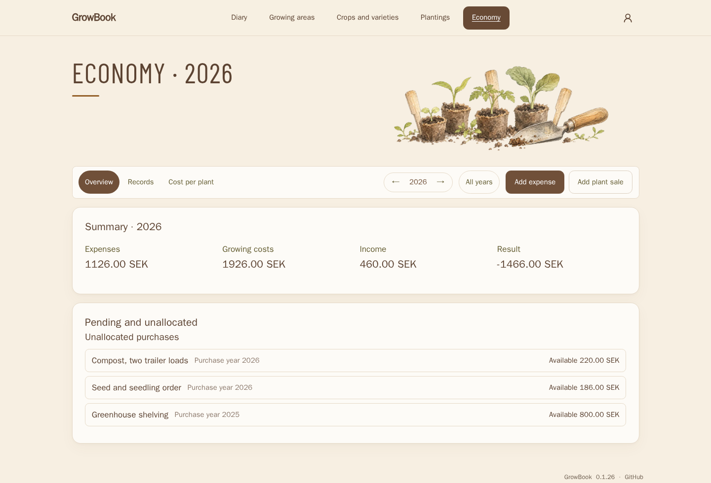
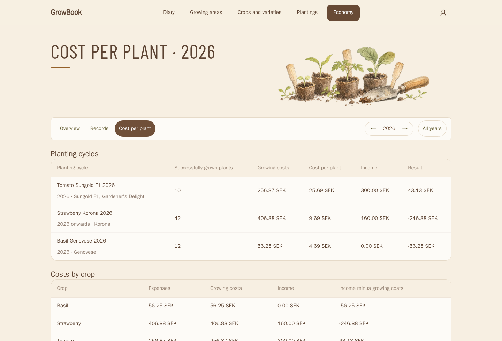

# Economy

**Economy** is a personal growing-cost estimate, not formal accounting: purchases,
how much of each purchase belongs to which growing year and planting, and plant sales.
Every active account can add, edit and delete economy records. Saving and retries are
shared; see [Getting started](getting-started.md).

## Pages and years

Every economy page shares one toolbar: **Overview**, **Records**, **Cost per plant**, the
year switcher with **All years**, and **Add expense** and **Add plant sale**. Year links
keep the filters of the page you are on, and a single year is always one step away.

- **Overview** covers one growing year with four figures: **Expenses** (cash purchases),
  **Growing costs** (allocated or periodized costs), **Income** and **Result** (income
  minus growing costs). Purchases and their annual shares can fall in different years, so
  cash expenses are never mixed into income. A panel lists plant-count splits whose amount
  is reserved and purchases with an unallocated balance; it is hidden when nothing is
  outstanding.
- **Records** carries the filters and the paginated expense and income tables. Filter by
  crop, variety or planting cycle; **Compare varieties** adds a variety overview.
- **All years** aggregates every year but includes scheduled equipment shares only up to
  the current year, so it never counts costs that have not happened yet. A year you select
  explicitly still shows that year's planned estimates.

One currency label applies to the whole installation and is set in configuration: `SEK`,
`EUR`, `USD`, `GBP`, `NOK` or `DKK`. It is presentation only; amounts are never converted.
Enter every amount on one consistent basis. Amounts keep exact two-decimal precision.

## Expenses and allocations

**Add expense** requires a description, purchase date, total price and the purchased
quantity with its unit. Litres and kilograms accept three decimal places; items are whole
numbers. The date defaults to today and may be earlier; the saved date's year becomes the
purchase year.

- A purchase reaches a crop, variety or cycle only through an allocation you add after
  saving. Open **Allocate expense**: the form shows the purchase year, the selected growing
  year and the amount still available, including amounts already reserved.
- A counted purchase uses the **quantity used** in its recorded unit, so 16 of 50 items
  stays 16 and is not rounded to a percentage. **By current plant quantities** gives cycles
  with more plants a larger share; **Equal division** gives each selected cycle the same
  share, then splits a cycle's share between its varieties. Assigning 40% of a 100 purchase
  distributes 40 and leaves 60 available.
- Choose selected cycles or all cycles of the growing year and see an **Estimated
  allocation** panel before saving. Without JavaScript, the saved purchase page shows the
  same estimates.
- Plant-count splits recalculate from each cycle's current **Quantity**, including every
  variety in a batch, so update that quantity to the number actually grown. An all-year
  group picks up new matching cycles; a selected group picks up new varieties within its
  cycles. Known zero quantities receive nothing. If a quantity is unknown, all are zero or
  the group is empty, the split stays pending: its amount remains reserved and unassigned
  until the counts are complete or the allocation is edited.
- Unassigned costs stay in the purchase year. Assigning part to another growing year moves
  only that part's growing cost; the money spent stays in the purchase year. Editing an
  allocation keeps its saved amount until you move the slider, so correcting the method or
  cycles never rounds the reservation.

### Equipment

Choose **Equipment** and a **Useful life (whole years)** to spread the cost over
consecutive calendar years from the purchase year, unused years included. A 900 purchase
with three years contributes 900 to expenses in its purchase year and 300 to growing costs
in each year. The purchase page separates the selected year's share and assignments from
future scheduled shares and links to each year.

Changing the cost or useful life updates the schedule; reduce or remove allocations first if
they would exceed a new annual share or fall outside the new period. Monetary splits
preserve the exact total after two-decimal rounding.

## Cost per plant

**Cost per plant** lists the planting cycles of the selected year — or of all years, with
each cycle's year shown — with plant counts, growing costs, cost per plant, income and
result, followed by crop and variety breakdowns. Each cycle opens its own page with every
allocation that reaches it. **Economy for this cycle** on a planting opens the same page.

Pending plant-count splits make cost-per-plant estimates unavailable, and a cost per plant
needs a known positive plant count.

## Plant sales

**Add plant sale** takes a description, date, whole number of plants sold, either a unit
price or a total amount, and a cycle or variety. A cycle supplies its crop and growing
year, and its variety when it has one member; for a shared batch, select a variety if known.
A cycle-wide sale follows the first remaining member, and annual or persistent cycles use
their own years. Sales leave planting quantities unchanged.

## Corrections, deletion and references

- Edit or delete an allocation to change its reserved amount or selected group. Deleting a
  purchase also removes its allocations and future equipment shares.
- Crop, variety and planting references protect deletion: financially referenced plantings
  and registers cannot be deleted until the references are removed or reassigned. A sold
  variety cannot be moved out of its source cycle while those sales refer to it.
- A saved purchase keeps its purchase year. The date can be corrected within that year; a
  different year means deleting and re-entering it.
- Harvested-produce sales and formal accounting are not supported.
