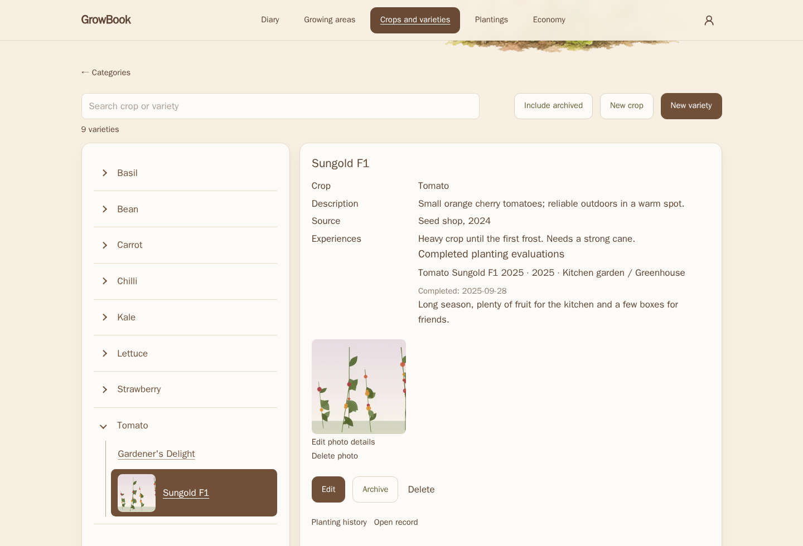
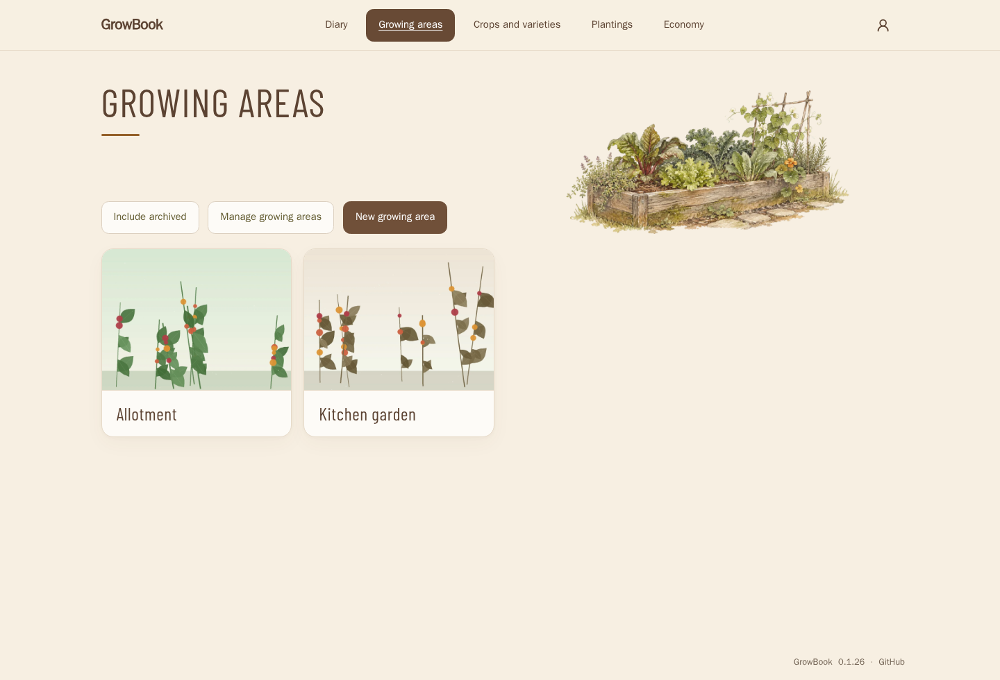

# Growing areas, crops and varieties

Two registers describe the garden. **Growing areas** are places, optionally nested. **Crops
and varieties** share one register: a crop groups its varieties and also works as a heading.
Both are maintained by every active account; saving, retries and photo limits are shared
and described in [Getting started](getting-started.md).

## Growing areas

**Growing areas** opens an overview of top-level area cards; open a card for the area's own
page.

- A card and an area page use the area's first photo when it has one, and a decorative
  illustration otherwise. Child-area cards appear before the parent's description,
  dimensions and photos, and each child has the same page layout, with links to the
  overview and ancestor areas.
- Areas may have a parent, a descriptive type and optional length and width in
  centimetres. A parent cannot be itself or one of its descendants; dimensions do not
  enforce a layout or capacity. Type accepts free text and suggestions such as **Raised
  bed** (**Pallkrage** in Swedish); stored text keeps the language it was entered in.
- Area pages list the plantings assigned directly to that area across all years, with
  **All years**, the current year and previous/next year. Child areas' plantings stay on
  their own pages.
- The latest linked diary observations include descendant areas and archived associations;
  each record appears once, and **View all observations** appears when older entries exist.
- **Manage growing areas** opens one maintenance list for top-level and child areas, shown
  by full path. **Include archived** there shows archived areas. Edit, Archive/Restore,
  confirmed Delete and photo maintenance all return to that list with your selection kept.

Archived ancestors of active areas remain visible as cards leading to their children;
unrelated archived branches stay hidden until **Include archived** is selected. Browsing,
cards, links and archive controls work without JavaScript.

## Crops and varieties

**Crops and varieties** always opens the category overview, including when you have not
created categories. Open a category card to browse only its crops and varieties,
**Uncategorized** for crops without a category, or **Show all crops and varieties** for the
full register.

- Crop names are group headings: activate one with mouse, Enter or Space to reveal its
  varieties. Groups start collapsed, several can stay open, and crops without varieties
  remain visible.
- Select a variety name to see its information in the details panel beside the list (below
  it on narrow screens). Selecting another name replaces the details, and selecting
  the same name again closes them. **Open record** or a new tab opens the full record page;
  **Back to list** returns to the selected name with the needed groups open.
- Varieties show their first photo as a thumbnail. **Diary observations (count)** expands
  the latest five; **View all observations** appears when older ones exist.
- **Experiences** on a variety shows its own notes followed by the evaluations of its
  completed plantings, oldest records and archived associations included. Corrections
  appear immediately; reopening a cycle hides its result.
- **Manage crops** opens maintenance links for crop notes, editing and archiving.

### Categories

Categories are shared, one level above crops, and a crop can belong to several. They exist
to browse a working subset, not to classify scientifically.

- **New category** takes a name, optional private image and selected crops. Transparent PNG
  and WebP images keep their transparency; one image is shown on the card and in the
  register heading. Categories without an image use the default illustration, and
  **Uncategorized** has its own.
- Empty categories stay available. **New crop** from a category page links the new crop to
  that category; from **Uncategorized** it stays unlinked. Saving or cancelling returns to
  the same category, search and archive filters.
- **Manage categories** edits names and crop links, replaces or removes the image, and
  deletes a category with confirmation. Deleting removes the category, its image and its
  links; crops, varieties, plantings and diary entries remain, and a crop without remaining
  categories appears under **Uncategorized**.

## Search and archive

**Search crops and varieties** matches literal substrings of variety or crop names after
Unicode normalization, whitespace collapsing and casefolding. Diacritics are significant;
notes and other fields are not searched.

- Search and the archive choice combine in the URL and keep each other. Clearing search
  keeps the archive choice; hiding archived varieties keeps the search.
- With JavaScript, search applies after a short pause or Enter, matching groups open, and
  Back restores the filter URL and results. A failed request keeps the current results and
  offers **Retry**. Without JavaScript, use **Apply**.
- **Include archived** shows or hides archived records in one click, with or without
  JavaScript, and keeps its selected state visible. Active varieties stay visible under an
  archived crop, marked with the crop's archive badge.

## Editing, archiving and deleting

- **Archive** hides a record from default lists and new associations, not from direct links,
  histories or existing associations. It does not archive child areas or varieties.
  Archiving is not cascading and can be reversed.
- Names are unique: crop names globally, variety names within a crop, area names among
  top-level areas or among siblings with the same parent. Comparison normalizes Unicode,
  collapses whitespace and casefolds; display names and notes are not translated. Archived
  records still reserve their names.
- A crop with varieties or an area with children cannot be deleted; archive it or move its
  dependents first. Referenced crops, varieties and areas cannot be deleted either.
  Deleting an allowed record also removes its photos, with the files cleaned up after the
  database commit.
- A variety used by any planting cannot change crop through an ordinary edit, even for an
  ended planting. Reconcile its plantings first; changing the variety never silently
  reclassifies them.
- Deletion and archive actions return to the page you came from, with its category, search
  and archive filters kept, including when the last visible record is removed.

Photos on varieties and areas are added and maintained through editing; captions and order
are edited per photo and deletion requires confirmation. See
[Photos](getting-started.md#photos).
