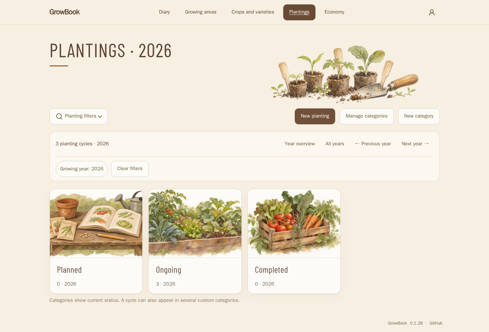
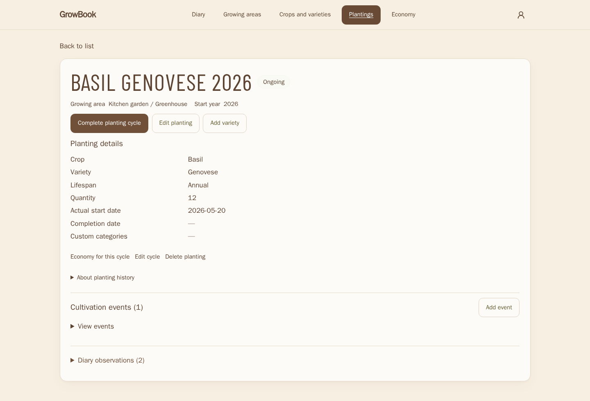

# Plantings

A planting records what you grow, where and in which year. Plantings created together —
for example several tomato varieties in the greenhouse — form one batch with a shared
cycle: one status, one set of actual dates, one growing year. Shared behavior is in
[Getting started](getting-started.md); crops, varieties and areas are described in
[Garden registers](garden-registers.md).

## Overview and categories

**Plantings** opens a card overview for one growing year. **Planned**, **Ongoing** and
**Completed** are built in and ordered that way; each batch has exactly one status. Open a
card to list its cycles, then select a name to open the details panel.

- **New category** creates a shared custom category such as *For sale*, with an optional
  private image. A cycle can belong to several, so an ongoing cycle can appear in both
  **Ongoing** and *For sale*. Categories persist across years; each card's count and year
  describe the current view, and counts may overlap.
- **Manage categories** edits or deletes custom categories. Deleting removes the category,
  its image and its memberships; cycles, members, history and photos remain.
- Year links, **All years** and the filters are all in the URL. A past-year view shows
  current status and current category membership, not a reconstruction of that year's
  lifecycle.

## A planting and its batch

**New planting** requires a crop and a start year. Variety and area may be unknown at first;
no placeholder records are created.

- **Planting label** names the individual planting. It defaults to crop–variety, or the crop
  alone when the variety is unknown, and follows your selections until you edit it. Several
  plantings may share a label.
- **Quantity** is a plant count: blank means unknown, zero is a known zero.
- **Annual** (default) belongs to its start year only and has no end year. **Persistent**
  belongs to every year from its start year through an optional inclusive end year; a blank
  end year leaves membership open. Viewing another year never copies the planting or counts
  its quantity again.
- **Add variety** starts another member of the same batch, preselecting crop, year, area and
  lifespan. Choose an unused variety of the same active crop. Each member keeps its own
  label, quantity, notes, evaluation, events, photos and diary links; the batch shares
  status, actual dates and categories. A batch with a known variety cannot be cleared back
  to unknown while it has other members.
- Each planting has one current area. Correcting that assignment or reparenting an area
  changes past-year results too. For a plant that moves, end the old planting and create a
  new one at the destination; this preserves year-level presence, not movement dates or
  lineage.
- New area choices offer active areas without children. An existing parent-area assignment
  stays selectable when editing.
- Editing a planting adds cumulative evaluation text and photos. **Complete planting cycle**
  is the history-preserving alternative to deletion.

## Status, start and completion

**Start cycle** changes Planned to Ongoing and asks for the actual start date, defaulting to
today in the garden's timezone. **Complete cycle** changes Ongoing to Completed and asks for
the completion date, offering each member's existing evaluation in a separate optional
field. **Edit cycle** corrects shared status, dates and categories, including returning to
Planned or reopening a completed cycle.

- Status transitions and corrections preserve IDs, events, photos and diary links.
  Evaluations change only when you supply new text; omitted values are kept.
- A completion date sets each persistent member's inclusive end year to that date's year.
  Annual members keep their start year and no end year. Invalid date order or incompatible
  member years reject the whole save.
- Reopening a completed cycle clears the completion date and persistent end years while
  keeping the planting's evaluation text.
- A stale cycle or member edit must be reloaded before a new save; identical retries
  acknowledge the earlier save.

## Events

**Cultivation events** record sowing, transplanting, replanting, harvest start, harvest end
and other milestones. Each member of a batch has its own events.

- A planned date, an actual date or both are required; they stay independent and do not
  change the growing year, the cycle status or each other.
- Repeated event types are allowed. Events can be edited and deleted, with confirmation for
  deletion.
- Events appear in the [calendar](calendar.md): an event with only a planned date shows as
  planned on that date, and an event with an actual date moves there and shows as done.

## Filtering and history

**Planting filters** starts collapsed above the results. Filter by crop, variety or area, or
find **Unassigned area only** or **Unknown variety only**. An area filter normally includes
the selected area and all child areas; each cycle counts once.

- All filters apply together to the same member. A batch with three matching varieties
  counts once and appears if at least one member matches everything; matching members are
  listed while the batch stays accessible in the details panel.
- Select a category to see one row per matching cycle; status appears only when the
  category does not supply it, and exact growing-year ranges appear in **All years**.
- Crop, variety and area histories default to all years and keep status and year ranges.
  Archived register items stay visible in existing histories and associations.
- With JavaScript, filter changes apply automatically, active choices stay visible as chips
  and a failed request keeps the results with **Retry**. Without JavaScript, use **Apply**;
  type a year or use **Previous year** and **Next year**.

## Deleting

Planting deletion is permanent: it removes the planting, its events and its photos.
Completing the cycle is the history-preserving alternative. A planting referenced by the
economy cannot be deleted until those references are removed or reassigned. Deletion from a
category returns to the same category and year with the other filters kept.
